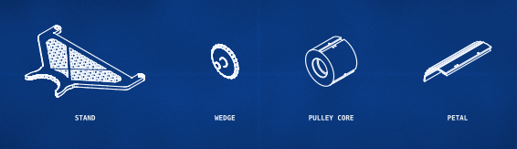

# Creality Space Pi X4 spool roller

  
  
  

Printable parts that let two filament spools roll freely on bearings inside a Creality Space Pi X4 dryer: two stands, two 608-bearing wedges, a clip-on pulley core and three soft petals per roller. It adapts the "SPACE PI - FREE ROLL MOD" by Alberto Maciel (see [NOTICE.md](NOTICE.md)) and adds a clip-on pulley with soft petals that grip spool bores of about 50 to 60 mm.

Built and installed on one printer and one dryer; long-term wear is still open (see Status). NOT FOR RESALE.

<!-- blueprint-preview:roller-preview -->

Preview generated from `tools/export_release.py (stl/stand_pi_x4.stl)` by [common-blueprint-generator](https://github.com/csmarshall/common-blueprint-generator) on every change to the model
<!-- /blueprint-preview -->

## Parts

| Part | STL | STEP |
|---|---|---|
| Stand (138 x 92.5 x 4 mm, flat on both faces, 24 ridge pockets, 4.05 mm foot holes) | `stl/stand_pi_x4.stl` | none (built from the upstream mesh) |
| Wedge (single sided, 24 ridges, 8.05 mm stub for a 608 bearing) | `stl/wedge_single_sided.stl` | none (built from the upstream mesh) |
| Pulley half, clip-on core | `stl/pulley_half_clip_on_core.stl` | `step/pulley_half_clip_on_core.step` |
| Soft ribbed petal (print three per pulley) | `stl/clip_on_petal_soft_ribbed.stl` | `step/clip_on_petal_soft_ribbed.step` |

One roller is stand, wedge, two core halves with three petals, wedge, stand; the stack between the stand faces is 72.60 mm.

### Tolerance coupons

Small prints to tune the fits on your own printer before committing to the big parts. All in `stl/`, STEP for those built with build123d.

| Coupon | Tests | Design value |
|---|---|---|
| `coupon_bearing_recess` | 608 bearing pressed into the recess | 22.0 mm bore, 7.0 mm to the shelf, 0.5 mm chamfer |
| `coupon_foot_hole` | the dryer's 4 mm spindle peg | 4.05 mm hole |
| `coupon_groove_24_teeth` | wedge ridges seating and locking in the stand pockets | 24 ridges, 0.3 mm pocket side clearance |
| `coupon_short_slot_clearance_0_10`, `coupon_short_slot_clearance_0_00`, `coupon_short_head_nominal` | the dovetail that holds each petal in the core | slot clearance 0.10 mm at the open end, 0.00 mm at the closed end |

## Blueprints

Drawn from the models by [common-blueprint-generator](https://github.com/csmarshall/common-blueprint-generator) and redrawn by the Publish workflow on every merge.

<!-- blueprint:stand -->

Drawing generated from `tools/export_release.py (stl/stand_pi_x4.stl)` by [common-blueprint-generator](https://github.com/csmarshall/common-blueprint-generator) on every change to the model
<!-- /blueprint -->

<!-- blueprint:wedge -->

Drawing generated from `tools/export_release.py (stl/wedge_single_sided.stl)` by [common-blueprint-generator](https://github.com/csmarshall/common-blueprint-generator) on every change to the model
<!-- /blueprint -->

<!-- blueprint:pulley_core -->

Drawing generated from `tools/export_release.py (step/pulley_half_clip_on_core.step)` by [common-blueprint-generator](https://github.com/csmarshall/common-blueprint-generator) on every change to the model
<!-- /blueprint -->

<!-- blueprint:petal -->

Drawing generated from `tools/export_release.py (step/clip_on_petal_soft_ribbed.step)` by [common-blueprint-generator](https://github.com/csmarshall/common-blueprint-generator) on every change to the model
<!-- /blueprint -->

## Print settings used

<!-- print-settings:begin (generated by tools/print_settings_table.py from 3mf/free_roll_x4_u1_abs.3mf; do not edit) -->
These are the settings stored in [`3mf/free_roll_x4_u1_abs.3mf`](3mf/free_roll_x4_u1_abs.3mf) (one dryer's set: two rollers, five plates), the same per-part settings the installed parts were printed with. Open the 3MF in Snapmaker Orca 2.4.1 and the per-part values are already applied.

| Part | Count | Layer | Walls | Top / bottom shells | Brim | Inner walls |
|---|---|---|---|---|---|---|
| Stand | 4 | 0.12 mm | 2 | 5 / 5 | outer, 8 mm | 300 mm/s, 10000 mm/s² |
| Wedge | 4 | 0.12 mm | 6 | 5 / 5 | auto, 5 mm | 300 mm/s, 10000 mm/s² |
| Pulley core half | 4 | 0.12 mm | 4 | 14 / 5 | outer, 4 mm | 300 mm/s, 10000 mm/s² |
| Petal | 6 | 0.12 mm | 6 | 5 / 5 | outer, 5 mm | 60 mm/s, 2000 mm/s² |

| Shared by every part | |
|---|---|
| Printer | Snapmaker U1 (0.4 nozzle), Snapmaker Orca 2.4.1 |
| Filament | ABS, nozzle 265 °C, bed 100 °C, chamber 60 °C |
| First layer | 0.2 mm |
| Infill | gyroid 15% |
| Outer walls | 60 mm/s, 2000 mm/s² |
| Part cooling fan | 10 to 50 % |
| Supports | off |
| Prime tower | off |
<!-- print-settings:end -->

Nozzle: 0.4 mm hardened steel. Print the stands flat. Other materials are untested. The tolerance coupons were tuned at 0.20 mm layers; the parts themselves print at 0.12 mm.

## Status

Seen on a print (one printer, 0.20 mm coupons): the 608 presses in flush by hand, the wedge stub is a good fit, the 4.05 mm foot hole is slightly tight but works, the dovetail slots slide and hold, and the wedge seats, locks and lifts out of the groove coupon.

Seen installed (one Space Pi X4): the stands stay flat and do not rub the spool, the whole stack spins freely with a spool loaded, the lid closes over a 200 mm spool, and the petals grip the spool bore.

Not yet verified: long-term strength of the petal necks and wedge stub. The sizes above came from one printer and one filament; expect to adjust.

## Rebuild

Python 3 with build123d, trimesh, numpy, scipy, shapely, matplotlib and manifold3d. Put the upstream 3MF in `src/` (see [NOTICE.md](NOTICE.md)), then:

    python3 tools/export_release.py

This runs every build script in `src/`, checks watertightness, that the final wedge clears the stand while a half-pitch turn locks, and that the stack is 72.60 mm with no overlaps, then copies the models to `stl/` and `step/`. The `.3mf` print-plate builders in `src/` also need a Moonraker printer holding a sliced coupon gcode (set `PRINTER_HOST`); the model builders do not. The release 3MF is `PRINTER_HOST=<host> python3 src/build_stack_by_part.py 2` (two rollers, one dryer) copied to `3mf/free_roll_x4_u1_abs.3mf`; then run `python3 tools/print_settings_table.py` to refresh the settings tables above (CI fails if they disagree).

A passing build shows the parts agree with the design values, not that they fit your printer.

## Licences

Models, drawings and documents: CC BY-NC-SA 4.0, not for resale. Code: MIT. See [LICENSE.md](LICENSE.md) for what that allows, [NOTICE.md](NOTICE.md) for the upstream credits, and `REUSE.toml` for the per-file map.
